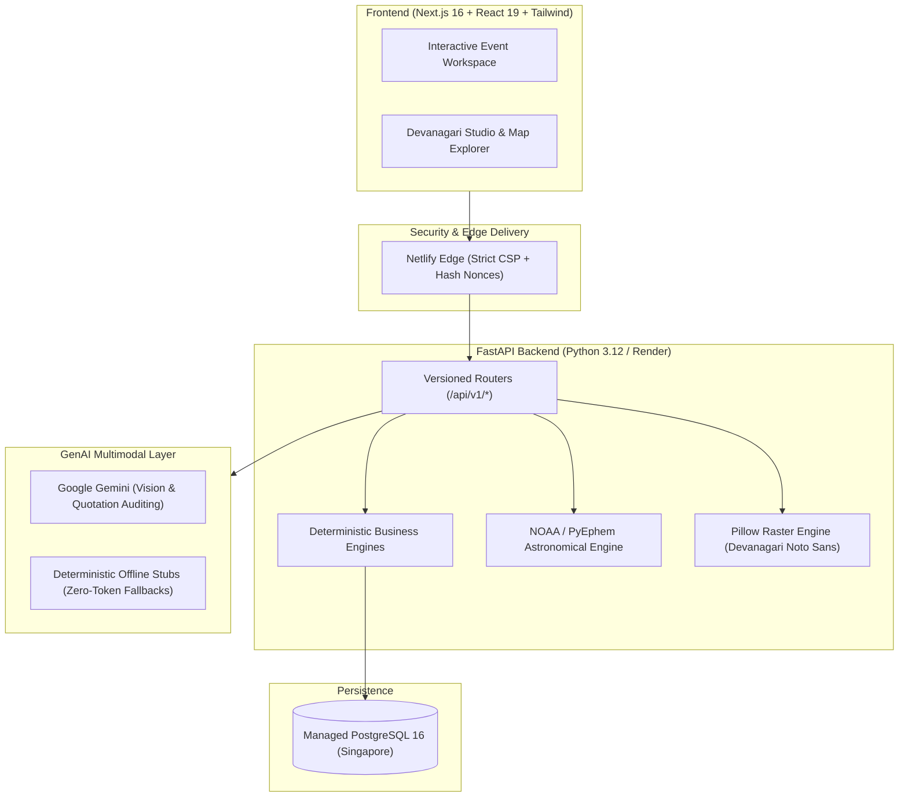

# Utsav (उत्सव) — Celebrations, Composed.

Utsav is a culture-native AI event planning platform for Indian celebrations — weddings, milestone birthdays, and community festivals. It integrates visual vibe extraction, formulaic budget rescaling, vendor quote auditing, astronomical panchang calculations, and Devanagari invitation generation into an unified event workspace backed by a deterministic, zero-hallucination computational core.

---

## 🌐 Live Production Links

* **Production Web App:** [https://utsav-ai.netlify.app](https://utsav-ai.netlify.app)
* **Backend API:** [https://utsav-ai-ycg2.onrender.com](https://utsav-ai-ycg2.onrender.com)
* **Service Health Check:** [https://utsav-ai-ycg2.onrender.com/health](https://utsav-ai-ycg2.onrender.com/health)
* **Master Architectural Specification:** [`docs/UTSAV_MASTER_DOC.md`](docs/UTSAV_MASTER_DOC.md)
* **Quality Baseline Report:** [`docs/QUALITY_BASELINE.md`](docs/QUALITY_BASELINE.md)

---

## 🏗️ System Architecture



---

## 📊 Rigorous Code Quality & Verification Gates

Utsav is verified continuously through strict static analysis, complete type safety, and comprehensive test coverage:

| Metric / Quality Gate | Target / Standard | Verified Status |
| :--- | :--- | :--- |
| **Ruff Linting** | Expanded rule set (`E, F, W, I, UP, B, C4, PIE, SIM, RUF, BLE, S, PTH, T20, C90`) | **0 Errors** (100% compliant) |
| **Max Cyclomatic Complexity** | Grade A / B only (`CC <= 10`) | **0 Functions with CC >= 11** |
| **Python Static Typing (MyPy)** | Strict (`disallow_untyped_defs`, `disallow_incomplete_defs`, `strict_equality`) | **0 Issues in 65 files** |
| **Backend Test Coverage** | Mandatory branch coverage threshold `>= 90%` | **92.4% Branch Coverage** (181 passed) |
| **Application Security (Bandit)** | Zero high or medium severity issues | **0 Issues detected** |
| **Frontend Static Types** | Strict TypeScript compilation (`strict: true`) | **0 Errors** (`tsc --noEmit`) |
| **Frontend Tests** | Vitest component & error state test suite | **16 / 16 Passed** |
| **Frontend Production Build** | Next.js 16 SSG with auto-extracted script hash CSP | **15 / 15 Pages prerendered** |
| **Accessibility** | Axe-core WCAG 2.2 AA Automated Scan | **0 Violations across routes** |

---

## 📁 Repository Structure

```
.
├── backend/                  # FastAPI Application Package
│   ├── alembic/              # Database migration versions
│   ├── app/
│   │   ├── api/v1/           # Versioned REST routers (thin endpoints)
│   │   ├── assets/fonts/     # Bundled Google Noto Sans Devanagari fonts
│   │   ├── core/             # Configuration, security, rate limiting
│   │   ├── db/               # SQLAlchemy models, sessions, tradition seeds
│   │   ├── schemas/          # Strict Pydantic v2 validation models
│   │   └── services/         # Deterministic business logic engines & providers
│   ├── requirements.txt      # Pinned production dependencies
│   └── alembic.ini           # Migration configuration
├── docs/                     # Architectural specs, audits & quality reports
│   ├── lighthouse/           # Automated performance & accessibility reports
│   ├── QUALITY_BASELINE.md   # Initial measurement baseline
│   └── UTSAV_MASTER_DOC.md   # Single source of truth architectural contract
├── frontend/                 # Next.js 16 Web Application
│   ├── app/                  # App Router views & layouts
│   ├── components/           # UI components & containers
│   ├── lib/                  # Shared API client & TypeScript interfaces
│   └── public/               # Static assets & CSP header configurations
├── marketing/                # Non-code assets & promotional pipelines
│   ├── brag/                 # Hackathon demonstration video & poster assets
│   ├── landing/              # Interactive 3D hero demo pages
│   ├── social/               # Social media preview captures
│   └── video_pipeline/       # Automated walkthrough video generation tooling
├── scripts/                  # Development & verification automation scripts
│   ├── audit/                # Axe accessibility and live verification scripts
│   ├── ci_test_runner.py     # Deterministic CI test dispatcher
│   └── seed_vendor_discovery.py # OpenStreetMap vendor directory seeder
├── tests/                    # Automated Test Suites
│   ├── eval/                 # Golden evaluation scenarios & invariants
│   ├── live/                 # Live external API integration checks (opt-in)
│   ├── schema/               # Pydantic schema validation tests
│   └── unit/                 # Feature-based unit & branch coverage tests
├── CONTRIBUTING.md           # Contribution guidelines & setup steps
├── Dockerfile                # Multi-stage production container image
├── LICENSE                   # MIT Open Source License
├── netlify.toml              # Edge routing & CSP security configuration
├── pyproject.toml            # Project metadata, tool configurations, dependencies
└── render.yaml               # Managed backend deployment specification
```

---

## 🛠️ Automated Scripts Index

| Script | Location | Purpose |
| :--- | :--- | :--- |
| `audit_axe_playwright.cjs` | `scripts/audit/` | Runs automated WCAG 2.2 AA accessibility scan with Playwright & Axe-core |
| `run_fresh_a11y.cjs` | `scripts/audit/` | Executes accessibility audit against local preview servers |
| `verify_live_e2e_a11y.cjs` | `scripts/audit/` | Verifies deployed production site accessibility and keyboard focus |
| `ci_test_runner.py` | `scripts/` | Executes test subsets in CI pipeline environments |
| `seed_vendor_discovery.py` | `scripts/` | Seeds real OpenStreetMap venues across major Indian metro centroids |
| `smoke_test_gemini.py` | `scripts/` | Verifies Google Gemini API connectivity and JSON schema mode |

---

## 🔐 Environment Variables

| Variable | Required | Default | Purpose |
| :--- | :--- | :--- | :--- |
| `DATABASE_URL` | Yes | `sqlite:///./utsav_dev.db` | PostgreSQL connection URL (or local SQLite file) |
| `GEMINI_API_KEY` | Optional | `None` | Google Gemini API key. If omitted, deterministic stubs activate safely |
| `GOOGLE_API_KEY` | Optional | `None` | Fallback alias for Google Gemini API key |
| `PORT` | Optional | `8000` | Port for the backend API server |
| `ENABLE_M4_WHATSAPP` | Optional | `false` | Feature flag to mount WhatsApp webhook and guest coordination endpoints |
| `WHATSAPP_PROVIDER` | Optional | `mock` | WhatsApp provider backend (`mock` or `meta_cloud`) |
| `ALLOWED_HOSTS` | Optional | `*` | Comma-separated list of permitted CORS and HTTP Host header values |

---

## ⚠️ Known Honesty Caveats

1. **Tradition & Ritual Data:** Cultural run-of-show schedules and samagri item checklists were compiled by AI as starting baselines. **None of the 21 database rows have been liturgically reviewed by priests or community elders.** All rows maintain `is_verified: false` with mandatory user-facing disclaimers.
2. **Panchang Coordinates:** Calculations use modern Drik Ganita orbital ephemeris models. Regional printed panchang almanacs (e.g., Kalnirnay, Vakya) may differ by 10–20 minutes due to distinct local horizon and refraction adjustments.
3. **WhatsApp Messaging Paused:** End-to-end messaging pipelines, templates, and opt-out blocklists are implemented in code but paused pending Meta Business compliance verification.
4. **Render Free-Tier Cold Starts:** Backend runs on Render's managed tier; initial requests after idle periods may require 45–60 seconds for spin-up.

---

## 📄 License & Contributing

* **License:** [MIT License](LICENSE)
* **Contributing Guidelines:** [CONTRIBUTING.md](CONTRIBUTING.md)
