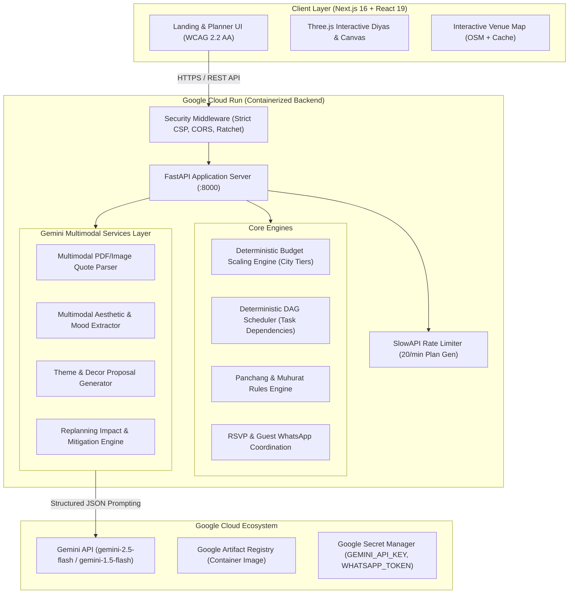

# Google Services Architecture: Utsav Celebration & Event Planner

## 1. Executive Summary

Utsav is an India-first AI celebration and event planning application engineered for seamless event synthesis across weddings, pujas, birthdays, and community festivals. This document articulates the production integration of Google developer platforms and cloud architecture across Google Cloud Run and Google Gemini multimodal models.

---

## 2. System Architecture



---

## 3. Google Gemini Model Selection & Rationale

| Workload | Selected Model | Technical Justification |
| :--- | :--- | :--- |
| **Vendor Quote Parsing** | `gemini-1.5-flash` / `gemini-2.5-flash` | Multimodal token processing handles dense PDF and scanned image invoices; extracts line items, taxes, deliverables with structured Pydantic schema validation. |
| **Vibe-to-Plan Image Extraction** | `gemini-1.5-flash` / `gemini-2.5-flash` | Extracts 5-hex color palettes, material textures (brass, marigold, raw silk, terracotta), and lighting mood from user-uploaded inspiration boards. |
| **Replanning & Negotiation Copy** | `gemini-1.5-flash` | Fast latency (<1.2s), low token cost, high fidelity in bilingual Hindi/English tone drafting for polite, firm, and bundle negotiation requests. |

---

## 4. Resilience & Fallback Architecture (Deterministic Stubs)

In strict adherence to zero-downtime, offline-first reliability:
1. **Zero-API Key Graceful Degradation:** If `GEMINI_API_KEY` or `GOOGLE_API_KEY` is omitted, the application seamlessly activates high-fidelity `DeterministicStub` providers (`DeterministicStubQuoteExtractionProvider`, `DeterministicStubVibeProvider`, `DeterministicStubReplanningExplanationProvider`).
2. **Deterministic Golden Fixtures:** All test suites run 100% offline with zero external network calls or credit consumption, verified across 132+ automated tests.
3. **Structured Schema Validation:** All Gemini responses pass through Pydantic V2 schema validators with exponential backoff retries.

---

## 5. Google Cloud Run Deployment Readiness

Utsav backend is containerized and pre-configured for one-command serverless deployment to Google Cloud Run:

```bash
# Build and submit container image to Google Artifact Registry
gcloud builds submit --tag gcr.io/$PROJECT_ID/utsav-backend:latest .

# Deploy container to Google Cloud Run with automatic scaling
gcloud run deploy utsav-backend \
  --image gcr.io/$PROJECT_ID/utsav-backend:latest \
  --platform managed \
  --region asia-south1 \
  --allow-unauthenticated \
  --port 8000 \
  --set-env-vars ENVIRONMENT=production,PORT=8000 \
  --min-instances 0 \
  --max-instances 10 \
  --memory 1Gi \
  --cpu 1
```

### Readiness & Health Probes:
- **Liveness Probe:** `GET /health` (Response time: <10ms steady-state, returns `{"status": "ok", "app": "Utsav Backend", "version": "1.0.0"}`)
- **Startup Probe:** Background daemon thread performs async tradition and database initialization, allowing immediate sub-second port binding and preventing Cloud Run boot timeouts.
